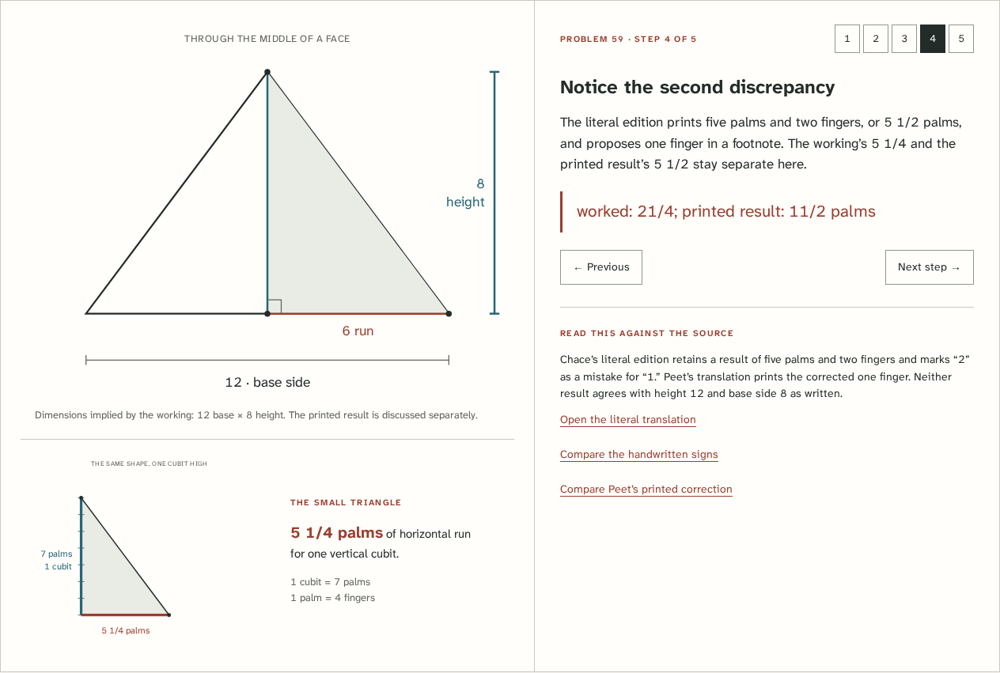

# Seked

**One cubit up. How far inward?** Read the Rhind papyrus's pyramid-slope problems
through exact fractions, proportional drawings and the printed evidence.

[](LICENSE)
[](https://antonsoo.github.io/seked/)

Problem 59 states one pair of dimensions, works with the opposite pair, and
ends with another numerical discrepancy. A calculator that quietly corrects
all three loses the most interesting part. Seked lets you draw both readings,
reconstruct the fraction rows, and compare the literal translation with the
original photographs and another edition's corrections.



[Begin with problem 56](https://antonsoo.github.io/seked/?p=56&step=0#reader) ·
[Read the mismatch in 59](https://antonsoo.github.io/seked/?p=59&rows=3&step=3&reading=written#reader) ·
[Follow the reciprocal in 60](https://antonsoo.github.io/seked/?p=60&rows=4&step=2#reader)

## Read, reckon, compare

- Six exercises, 56–60 including 59B, each with five explanatory steps. Drawings
  retain the completed dimensions while the selected step emphasizes an operation.
- Exact fraction rows that can be selected with a mouse or keyboard. Source
  choices and extra modern comparisons are labeled; two thirds remains two thirds.
- A one-cubit triangle with seven palm divisions, beside the full section at
  equal horizontal and vertical scales.
- A separate square-pyramid experiment: compare a face midpoint section with
  a corner section. The larger half-diagonal gives a gentler edge, without
  changing the face seked. Whole, decimal, fractional and mixed-number inputs work.
- Four source-linked Egyptian word notes, with consonantal transliterations
  distinguished from reconstructed pronunciation.
- Thirteen complete edition scans, including the hieratic facsimiles,
  hieroglyphic transcriptions, literal translations and overlapping photographs.
  Enlarge and pan; the selected problem determines the initial passage.
- Shared links retain the reading, step, selected rows and separate experiment.
  Save an illustrated HTML reading with its source pages embedded, or download
  exact quantities as CSV. The app and all scans work offline after installation.

## The numbers that matter

These are separate readings or calculations, not interchangeable answers.

| Problem / reading              |        Base side | Vertical height | Horizontal palms per vertical cubit | What is retained                                            |
| ------------------------------ | ---------------: | --------------: | ----------------------------------: | ----------------------------------------------------------- |
| 56                             |              360 |             250 |                   126/25 = 5 + 1/25 | Written decomposition 1/2 + 1/5 + 1/50                      |
| 57 and 58                      |              140 |           280/3 |                      21/4 = 5 + 1/4 | Inverse and forward operations                              |
| 59, stated dimensions          |                8 |              12 |                                 7/3 | The literal statement                                       |
| 59, dimensions used in working |               12 |               8 |                                21/4 | The arithmetic; literal final result remains 11/2           |
| 59B, editorial correction      |  12, interpreted |   8, calculated |                                21/4 | The written final 4 is reported separately                  |
| 60, analogous inward measure   | 15, base measure |              30 |                     7/4, calculated | The written result is 4 in the opposite direction, rise/run |

A saved problem-59 CSV identifies its reading explicitly:

```csv
scope,problem,dimensions,base,height,halfBase,runPerCubit,palms,fingers,risePerRun
reading,59,working,12,8,6,3/4,21/4,21,4/3
experiment_face,59,modern_experiment,12,8,6,3/4,21/4,21,4/3
```

The experiment row reports the **face** quantities even when the displayed
section crosses a corner; the label states that distinction. Its corner
inclination involves a square root and is displayed as a rounded modern angle.

## Run locally

Node.js 24 or newer. No runtime dependencies or external services.

```sh
git clone https://github.com/antonsoo/seked.git && cd seked
npm ci
npm run dev
```

Open `http://127.0.0.1:4370/seked/`. `npm run build` writes the complete static
site to `dist/`; `npm run preview` serves it at `http://127.0.0.1:4371/seked/`.
The development server deliberately does not install a service worker.

## How it works

The calculation is a ratio of lengths with different unit names:

```text
base side B ----> half-base B/2 ----> (B/2)/height H ----> x 7 palms/cubit
                   horizontal run     cubits per cubit     seked in palms
```

`src/core/fraction.ts` uses normalized `BigInt` fractions. Input is bounded
before conversion; invalid or out-of-range dimensions leave the last valid
experiment visible. `src/core/geometry.ts` converts to floating point only for
coordinates and modern degree labels. Both axes use one scale. Very flat or
narrow sections remain proportional and receive an explicit visibility note.

The lesson dimensions are independent of the experiment. `src/content.ts`
records the editorial choices beside each exercise. The reckoning table's
choices are an explicit teaching model, not a general reconstruction of all
Egyptian calculation procedures.

The source viewer carries complete pages, not OCR substitutions. Standalone
HTML embeds the selected original JPEG bytes after SHA-256 verification. The
build produces a service worker with an integrity digest for every file;
“saved offline” requires the complete current edition. A failed source response
cannot silently become a verified edition or an illustrated reading.

## Accuracy and limitations

This is a guided reading of the 1923 and 1929 editions, with new English
explanations. It does not establish a newly authoritative Egyptian text. Both
editions adopt a face-slope interpretation; the older interpretation involving
an edge is a historical disagreement, distinct from the app's modern corner
experiment. The full apparatus and diagrams remain available for inspection.

No pyramid is surveyed here. A generic section does not establish an ancient
construction method, building dimension or intended angle. Problem 60's solid
remains uncertain. Problem 56's initial lengths lack an explicit unit in the
literal text; the drawing uses a consistent common unit and its ratio is
unit-independent. No conversion to metres is assumed.

The British Museum dates the copy to about 1550 BCE; the source editions were
published much later. See [source provenance and rights](THIRD_PARTY.md) for
exact PDF pages, editions, image identities and the distinction between the
historic photographs and current museum images. Transliteration is not a
pronunciation lesson. Browser angles and diagram coordinates are rounded.

## Verification and saved examples

[The review](docs/review.md) separates the arithmetic, actual browser readings,
source identity, saved/printed output, offline behavior and published files.
The independent Python oracle imports no application code. It transcribes the
source numbers directly and checks both face and corner geometry, all selectable
fraction subsets, and actual browser SVG coordinates.

```sh
npm run check
npm run verify:geometry
npm run test:browser
```

The last command requires `npm run preview` in another terminal and installed
Playwright Chromium/Firefox browsers. It checks the 1440 px and 375 px workflows,
source navigation, native sharing, HTML/CSV exports and actual offline reloads.
Then compare the recorded coordinates with:

```sh
python3 scripts/geometry-oracle.py --rendered < /tmp/seked-browser/rendered.json
node scripts/offline-review.mjs dist /tmp/seked-offline.json
```

The offline review holds a source beyond eight seconds, then supplies a valid
but incorrect JPEG in a separate installation. It verifies pending status,
refusal to export the substituted source, recovery, and use without the origin.

[Illustrated problem-59 reading](examples/problem-59-working.html) ·
[Printed reading, PDF](examples/problem-59-working.pdf) ·
[Exact CSV](examples/problem-59-working.csv)

## Contributing

Corrections should identify the edition and exact passage. Keep written
numbers, editorial corrections and modern calculations distinguishable.
See [CONTRIBUTING.md](CONTRIBUTING.md).

## License

Code and new illustrations: [MIT](LICENSE), Anton Soloviev, 2026.
Historical pages and fonts: [separate notices](THIRD_PARTY.md).
